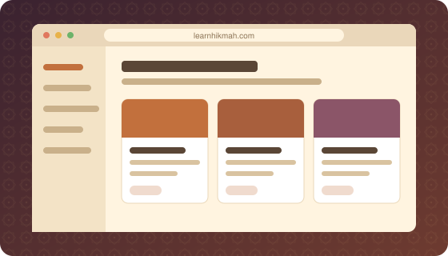
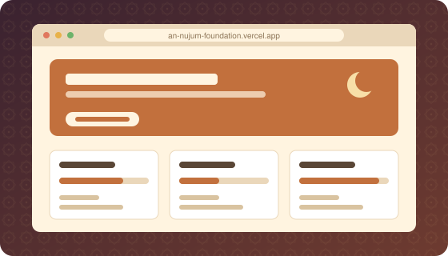
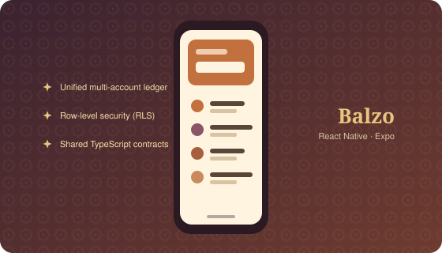
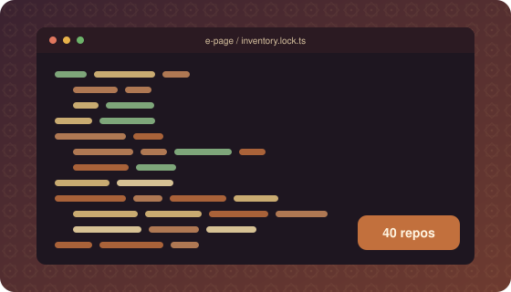

<!-- ===================== BANNER ===================== -->
<p align="center">
  
</p>

<p align="center">
  
</p>

<p align="center">
  
  &nbsp;
  
</p>



## 💻 Tech Stack

<p align="center">
  <a href="https://skillicons.dev">
    
  </a>
</p>

<p align="center">
  <strong>Modern Libraries &amp; Ecosystem</strong><br><br>
  <code>DaisyUI</code> • <code>Hero UI</code> • <code>Framer Motion</code> • <code>Better Auth</code> • <code>React Native / Expo</code>
</p>


## 👨‍💻 About Me

<table>
  <tr>
    <td width="60%">
      <p>
        Hi, I'm <strong>Naym</strong> — a <strong>Full-Stack Developer</strong> from Dhaka. I build web and mobile apps, and explore AI agents to work smarter and faster.
      </p>
      <ul>
        <li>🔭 <strong>Building:</strong> <a href="https://learnhikmah.com">LearnHikmah</a>, <a href="https://github.com/balzo-app">Balzo</a>, and leading tech at <strong>An-Nujum Foundation</strong>.</li>
        <li>🌱 <strong>Exploring:</strong> Agentic AI workflows &amp; modern backend patterns.</li>
        <li>💬 <strong>Let's chat:</strong> Architecture trade-offs, clean schemas, or building with AI agents.</li>
        <li>🌿 <strong>In my quiet time:</strong> Studying the Quran, trying to practice what I learn.</li>
      </ul>
    </td>
    <td width="40%">
      
    </td>
  </tr>
</table>


## 🧭 Now

| | |
|---|---|
| 🛠️ **Building** | LearnHikmah platform &amp; Balzo finance app |
| 📚 **Learning** | Agentic AI tool-calling, modern backend patterns |
| 🤝 **Open to** | Full-Stack &amp; AI Engineer roles (Remote or Dhaka) |
| 🔄 **Last refreshed** | <!--UPDATED_START-->2026-10-29<!--UPDATED_END--> |

<!--AYAH_START-->
<p align="center">
  <sub>✦ AYAH OF THE DAY ✦</sub>
</p>
<h3 align="center" dir="rtl">أَيَعِدُكُمْ أَنَّكُمْ إِذَا مِتُّمْ وَكُنتُمْ تُرَابًۭا وَعِظَٰمًا أَنَّكُم مُّخْرَجُونَ</h3>
<p align="center"><i>Does he promise you that when you have died and become dust and bones that you will be brought forth [once more]?</i></p>
<p align="center">সে কি তোমাদেরকে এই ওয়াদা দেয় যে, তোমরা মারা গেলে এবং মৃত্তিকা ও অস্থিতে পরিণত হলে তোমাদেরকে পুনরুজ্জীবিত করা হবে?</p>
<p align="center"><sub>— Surah Al-Muminoon 23:35</sub></p>
<!--AYAH_END-->


## 🚀 Selected Production Systems

<table>
  <tr>
    <td width="50%" valign="top">
      <a href="https://learnhikmah.com"></a>
      <h3>📘 LearnHikmah</h3>
      <p>Full-stack monorepo featuring an SSR portal and a secure LMS with strict RBAC.</p>
      <p><b>Outcome:</b> sub-50ms edge-cached course catalog · strict role isolation across students, instructors &amp; admins</p>
      <p>
        
        
        
        
      </p>
    </td>
    <td width="50%" valign="top">
      <a href="https://an-nujum-foundation.vercel.app"></a>
      <h3>🤲 An-Nujum Foundation</h3>
      <p>Public philanthropic portal designed for donor transparency and seamless mobile giving.</p>
      <p><b>Outcome:</b> streamlined program publishing · donor transparency · mobile-first giving</p>
      <p>
        
        
        
        
      </p>
    </td>
  </tr>
  <tr>
    <td width="50%" valign="top">
      <a href="https://github.com/balzo-app"></a>
      <h3>💰 Balzo</h3>
      <p>Modern finance app built solo with React Native, TypeScript, and Supabase RLS.</p>
      <p><b>Outcome:</b> shared TypeScript financial contracts across mobile and the upcoming web app</p>
      <p>
        
        
        
      </p>
    </td>
    <td width="50%" valign="top">
      <a href="https://github.com/nymulislam?tab=repositories"></a>
      <h3>🧩 Open-Source Work</h3>
      <p>Specialized tools spanning atomic e-commerce locks, digital healthcare, and AI agent workflows.</p>
      <p><b>Outcome:</b> 40 repositories across 2 organizations</p>
      &nbsp;
      <p>
        
        
      </p>
    </td>
  </tr>
</table>

<details>
  <summary><b>📂 More open-source projects (click to expand)</b></summary>
  <br>

  - **E-Page** — MERN commerce app with atomic inventory locks
  - **IlmMed** — healthcare web suite
  - **Job Heaven** — recruitment web suite
  - **Agentic AI tools** — deterministic tool-calling workflows
</details>


## 📊 By the Numbers


<p align="center">
  
</p>

<p align="center">
  
</p>

<p align="center">
  <picture>
    <source media="(prefers-color-scheme: dark)" srcset="https://raw.githubusercontent.com/nymulislam/nymulislam/output/github-snake-dark.svg" />
    
  </picture>
</p>


## 💡 Developer Philosophy

```ts
while (alive) {
  learn();
  build();
  stay_humble();
  seek_ihsan();
}
```


## 📬 Connect With Me

<p align="center">
  <a href="https://linkedin.com/in/nymulislam" target="_blank" rel="noopener noreferrer">
    
  </a>
  &nbsp;
  <a href="https://wa.me/8801822667737?text=Assalamu%20Alaikum%20Naymul%2C%20I%20reviewed%20your%20profile%20and%20would%20like%20to%20discuss%20an%20engineering%20opportunity%20or%20collaboration." target="_blank" rel="noopener noreferrer">
    
  </a>
  &nbsp;
  <a href="mailto:naymulislam241@gmail.com" target="_blank" rel="noopener noreferrer">
    
  </a>
</p>

<p align="center">
  
</p>
